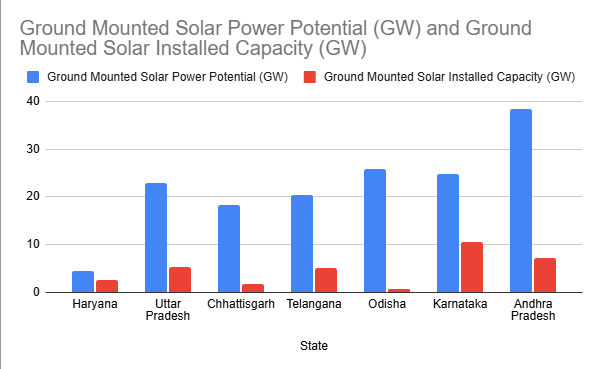

# About the company

GMR Group is a leading Indian infrastructure conglomerate with a diversified presence across Airports, Energy, Transportation, Urban Infrastructure, and Sports. With over two decades of experience, the Group has built world-class assets and pioneered innovations in sustainable infrastructure development.

# My Responsibilities

- Conducted comparative renewable-energy analysis across 8 Indian states, evaluating policies, incentives, approval mechanisms,
  land provisions, and project-development requirements, for a solar-wind hybrid power plant.
- Assessed substations, grid connectivity, evacuation capacity, transmission constraints, and planned network expansions for connection feasibility.
- Compared open-access economics, including wheeling, intrastate transmission, CSS, additional surcharge, electricity duty, and
  other state-specific charges.

# My Learnings

The internship was a great opportunity to connect with people in the industry and get to know how the process of generating and distributing renewable energy works. I learnt that energy companies have to meet the regulations set by the state government before deciding the plant site and looking at the technical feasibility.

The main factors that are considered in order to finalize a site are environmental effects such as temperature, shading and latitude, as well as the feasibility of grid connectivity, including distance from the nearest substation and available evacuation capacity.

After potential sites are identified, the decision is narrowed down based on the total cost incurred. States that offer incentives are usually favored.

I was also able to use MATLAB, which I had learned in UB, to plot the projected energy consumption for each state as a single comparative graph, and include it in the final report, as shown in figure [5].

_Figure 5: Ground Mounted Solar Potential vs Capacity_

Overall, it was a very good experience. I gained insight about the industry and built on what I learned in my masters degree.
