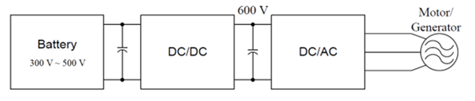

During my undergraduate studies, I developed an interest in power and energy
systems due to courses like ‘Power Electronics & Instrumentation’, which dealt
with switching devices and transducers. I realized that power and energy are
very important in supporting all the technology around us and wanted to gain
experience and dive deeper into the field. The course ‘Power Electronics’ is the
first one I chose as it is integral to understand the principles and applications of
power electronic converters. It proved very useful to learn about switches,
rectifiers, inverters and switching techniques.

The course also covered the topics Pulse Width Modulation (PWM), sinusoidal
PWM, six-step operation, switching losses and snubber circuits, along with
analysis and practical exercises. These helped me get an understanding of the
theoretical working principles of the converters and how power conversion can
be effectively controlled.

I also learned how to adjust the performance of a converter using the design
parameters like duty cycle, switching frequency, inductance and capacitance.
Practical issues in design like switching transient time, heating due to current
and voltage changes were also discussed. I found it particularly interesting to see
how the theoretical concepts of switching devices and converter operation can
be applied to improve the efficiency and reliability of real-world electrical
systems.

The final project helped me improve my skills in MATLAB and Simulink, which
involved the design of an Electric Car Traction Drive System, as shown in Figure 1.

_Figure 1: Electric Car Traction Drive System_

The components of the system are an energy storage device (battery), power
electronics converters and electric motor. The thermal management of the IGBT
used in the converter was also addressed in the design.

Overall, the course strengthened my interest in power electronics and its
applications such as renewable energy, electric vehicles, and grid-connected
power systems. The combination of circuit analysis, simulation, and practical
design considerations helped me develop skills that I can apply to future
coursework and engineering projects. I believe the knowledge gained from this
course provides a useful foundation for further study in advanced power
converters, power semiconductor devices, and renewable-energy-based power
systems.
