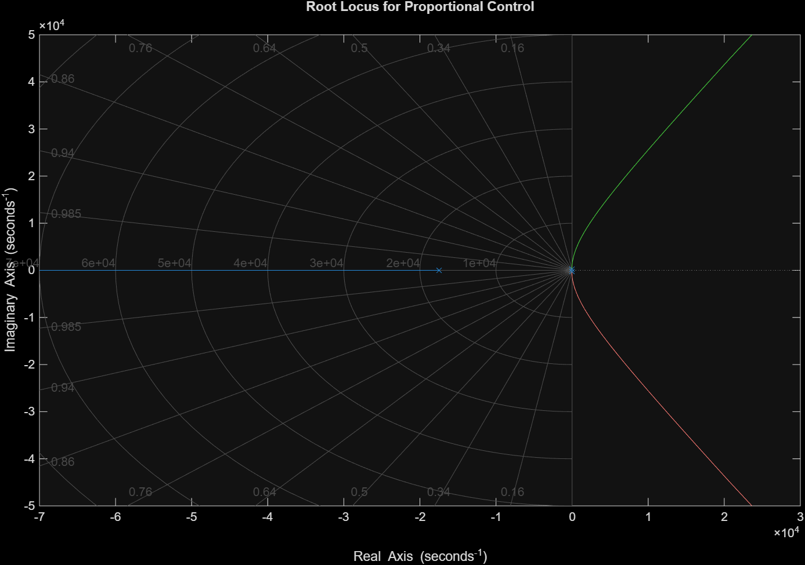

Industrial Control Systems turned out to be a very important course for many
aspects of designing a system, as control theory is the foundation of several
industrial processes, including electrical systems.

I learned a lot of useful concepts in this course, such as feedback control, system
modelling, stability analysis using Laplace transform and steady-state mechanics.
Different controllers like PD, PI and PID were analyzed for their steady-state
response. This showed how system output can be controlled by implementing
mathematical concepts. I found it fascinating how small changes in controller
parameters can significantly affect the stability of an entire system. This helped
me appreciate the importance of careful analysis while developing reliable
industrial automation solutions.

This course also helped with my MATLAB skills, as it was used to demonstrate
the underlying mathematics with the help of coding exercises. For example,
Figure [2] shows the root locus for an electrical system with only a proportional
controller.

_Figure 2: Root Locus for Proportional Control_

As the proportional gain is increased, the complex poles go to infinity, crossing
over to the positive real axis. This makes the system unstable.

Overall, the course gave me a better understanding of the role of automation
and control in modern industrial applications. The concepts learned can be
applied to areas such as motor control, process automation, power and energy
systems. The skills developed through the course will be useful in future
engineering projects and in understanding the control requirements of
increasingly automated electrical and industrial systems.
