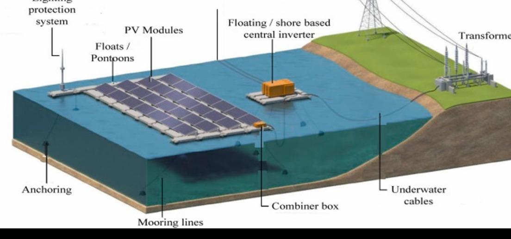

The course ‘Photovoltaic Tech & App’ was probably one of the best courses I
have taken so far. Dr. Ian Sellers is a really good professor, who made lectures
interesting using meaningful interactions and career stories. I decided to take
the course as PV systems are being widely used in power electronics as part of
the increasing implementation of renewable energy, which is in high demand by
many industries.

Besides the underlying principle of photovoltaic effect and solar cell operation, I
learned how semiconductors are selected for solar cells based on factors like
bandgap, efficiency, parasitic effects and external factors. In addition, the course
also covered the various applications of PV modules and the different ways of
connection to the power grid. What I had learnt in ‘Power Electronics’ the
previous semester was very helpful, as the concept of power conversion had to
be applied to PV modules to transfer power to the grid.

The final presentation was on ‘Floating Photovoltaics’, which is one of the most
interesting applications of PV modules, where they are installed on water bodies
such as lakes when land availability is restricted. As shown in Figure [3], they are
placed on pontoons, and the supporting infrastructure is anchored underwater.

_Figure 3: Floating PV System Structure_

The course proved very helpful for my summer internship with GMR Group in
New Delhi, India, where I had to analyse the renewable energy potential and
power connectivity (grid capacity) for selected sites for a solar-wind hybrid plant.
The environmental effects of temperature, shading and latitude, as well as
system parameters learned in the course were used for the analysis.

Overall, the course increased my interest in renewable energy and helped me
understand the important role of photovoltaic technology in the transition
toward sustainable power systems. It also complemented my understanding of
power electronics and electrical power systems by showing how solar generation
interacts with the power grid.
