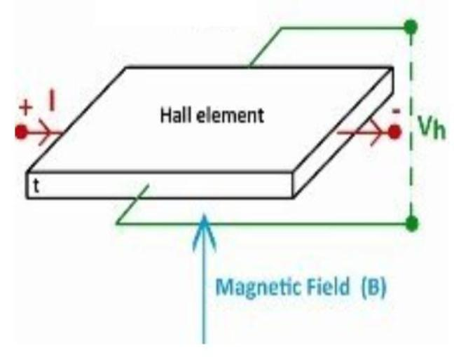

I decided to take ‘Solid State Sensors’ as I found it very interesting. Sensing
technologies can be used even in power systems like PV modules, which include
temperature sensors.

I learned how physical quantities such as temperature, pressure, light, magnetic
fields, and mechanical forces can be detected and converted into electrical
signals using solid-state devices. The course provided an understanding of the
relationship between semiconductor material properties, device structures, and
sensor behavior.

The most interesting topic I learned was the Hall Effect, which allows voltage
generation perpendicular to the current induced by a magnetic field (shown in
Figure [4]). This allows contactless sensing of motion in devices that involve an
external input, which was the focus of my final presentation in the course. It was
a really good experience learning how Hall Effect sensors revolutionized the
consumer electronics industry, due to their recent implementation over
mechanical sensors in foldable smartphones, laptop lids, smart watch rotary
crowns and even in computer devices like keyboards.

_Figure 4: Illustration of the Hall Effect_

Overall, the course gave me a broader understanding of the role of sensors in
modern electronics. I found it interesting how changes in physical quantities can
be detected through semiconductor properties and converted into measurable
electrical signals. This gave me a greater appreciation for the role of sensors in
connecting the physical world with modern electronic systems.
